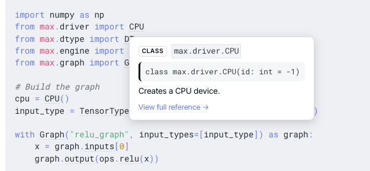

# docusaurus-plugin-api-hover

Give your API docs IDE-style hovers. Identifiers that reference a documented
symbol get a dotted underline, in code blocks and in prose. Hover one and
every other mention of the symbol on the page lights up. A tooltip shows its
kind, full name, signature, and a link to its reference page.

Resolution is snippet-aware. After `from mypackage import mod`, the name
`mod.Thing` resolves to `mypackage.mod.Thing`. After `device = Accelerator()`,
the attribute `device.id` resolves to the `id` attribute of the class,
following documented base classes when the class itself doesn't define it.

You supply the symbol data: a names JSON generated at build time, and an
info JSON with signatures and doc summaries that the browser fetches on
first hover. Everything else ships in the plugin.

<picture>
  <source media="(prefers-color-scheme: dark)" srcset="media/hover-dark.png">
  
</picture>

## Install

```bash
npm install docusaurus-plugin-api-hover
```

## Quick start

Register the plugin for code blocks, and the rehype pass for prose mentions.
The plugin annotates code blocks as they render; the rehype pass annotates
prose at build time. The plugin entry also needs the names JSON, which you
generate in a prebuild step (see [Index files](#index-files)).

```js
const path = require('path');
const apiHoverRehype = require('docusaurus-plugin-api-hover/rehype');

const dataFile = path.resolve(__dirname, 'generated/api-hover-names.json');

module.exports = {
  plugins: [
    [
      'docusaurus-plugin-api-hover',
      {
        dataFile,
        infoUrl: '/data/api-hover-info.json',
        preferPrefixes: [],
        languages: ['python'],
      },
    ],
  ],
  presets: [
    [
      '@docusaurus/preset-classic',
      {
        docs: {
          rehypePlugins: [[apiHoverRehype, { dataFile }]],
        },
      },
    ],
  ],
  markdown: {
    rehypePlugins: [[apiHoverRehype, { dataFile }]],
  },
};
```

Register the rehype pass wherever markdown is rendered: in the docs plugin
config for docs pages, and in the top-level `markdown` config for MDX pages.
A mention inside a link to the symbol's page takes its id from the href, so
links resolve even when the bare name is ambiguous.

Serve the info JSON from `static/` so it's available at `infoUrl`.

If `dataFile` doesn't exist when the build starts, the plugin falls back to an
empty index. The build succeeds and hovers stay inert until you generate the
index.

## Options

Set [`dataFile`](#index-files) to the names JSON your prebuild generates. It
is the one required option; the rest have defaults:

| Option           | Default                     | What it does                                |
| ---------------- | --------------------------- | ------------------------------------------- |
| `dataFile`       | none                        | Path to the generated names JSON.           |
| `infoUrl`        | `/data/api-hover-info.json` | URL the browser fetches the info JSON from. |
| `preferPrefixes` | `[]`                        | Id prefixes that win short-name collisions. |
| `languages`      | `['python']`                | Languages to annotate. Built in: `python`.  |

The rehype pass takes `dataFile`, `preferPrefixes`, and `apiBasePath`
(default `/api`). `apiBasePath` sets which link hrefs count as links to API
pages.

## How names resolve

An identifier in a Python snippet is resolved against the index using the
snippet's bindings:

- Exact dotted id: `mypackage.MyClass` resolves when it's in the index.
- Import aliases: after `from mypackage import mod`, the name `mod.Thing`
  resolves to `mypackage.mod.Thing`.
- Unique short names: `MyClass` resolves when exactly one indexed id ends
  with it.
- Inferred local types: after `device = Accelerator()`, the attribute
  `device.id` resolves to the `id` attribute, including attributes inherited
  from documented base classes.

Names the snippet binds itself stay plain. A local variable called `buffer`
is your variable, never the `Buffer` class, even when the short name would
match. A name that could match more than one symbol also stays plain.

`preferPrefixes` breaks those collisions: the id carrying a listed prefix
wins. Use it when the index mixes your symbols with ids from another source,
such as the Python standard library.

## Sites that ship their own Root

Docusaurus renders the Root of the last plugin that provides one. If another
plugin in your `plugins` array ships a `Root` and is registered after this
one, its Root wins. This plugin's Root, which mounts the hover runtime, never
runs.

Register this plugin first, then mount the runtime at the layout level:

```js
import ApiHoverRuntime from 'docusaurus-plugin-api-hover/runtime';
import 'docusaurus-plugin-api-hover/styles';

// In src/theme/Layout/Provider/index.tsx:
// composeProviders([..., ApiHoverRuntime])
```

The `styles` import supplies the hover styling; the runtime component ships
without a stylesheet of its own.

## Index files

The names JSON (`dataFile`) lists every annotatable symbol:

```json
{
  "ids": ["mypackage.MyClass", "mypackage.MyClass.my_method"],
  "bases": { "mypackage.MySubClass": ["mypackage.MyClass"] },
  "version": "0.1.0"
}
```

`ids` are dotted symbol names. `bases` maps each class to its documented base
classes, which drives inherited-attribute lookup. `version` is appended to the
info fetch as a cache-busting query, so a new info JSON can't be served
stale from the browser cache.

The info JSON (served at `infoUrl`) holds what the tooltip shows:

```json
{
  "mypackage.MyClass": {
    "kind": "class",
    "url": "/api/mypackage/MyClass",
    "sig": "class MyClass(...)",
    "doc": "First line of the docstring summary."
  }
}
```

`kind` is a free-form label shown as a badge, such as `class`, `method`, or
`function`. `sig` and `doc` are optional. An entry without them shows the name
and the reference link only.

## Development

```bash
npm install
npm run build
npm test
```

## License

MIT
